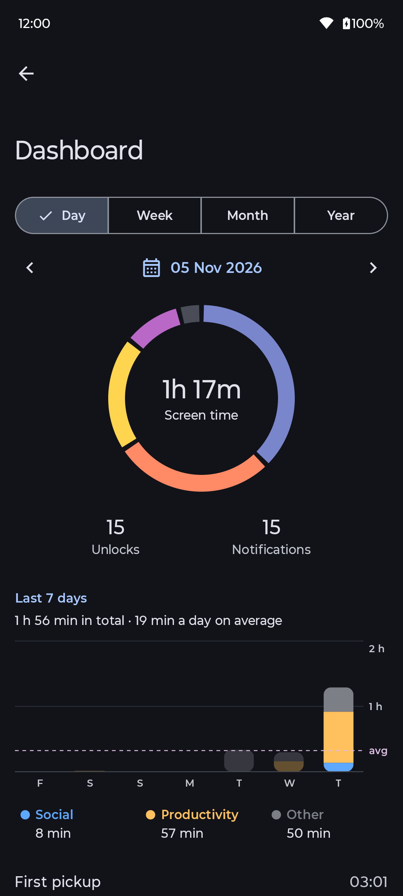
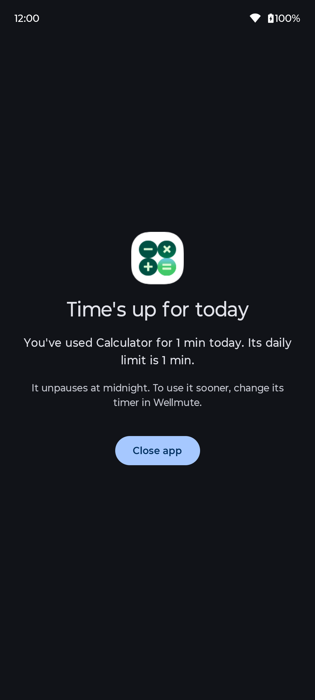
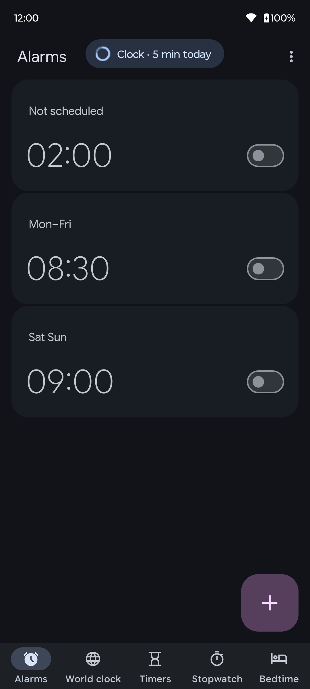
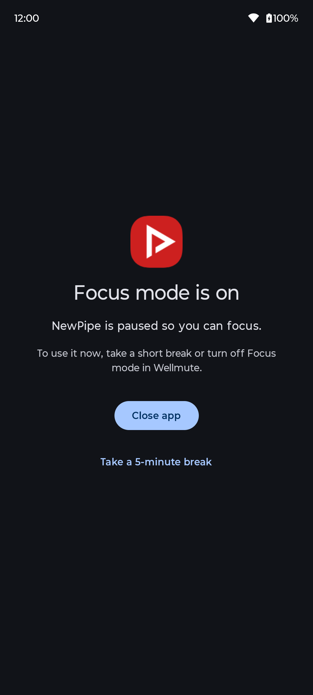
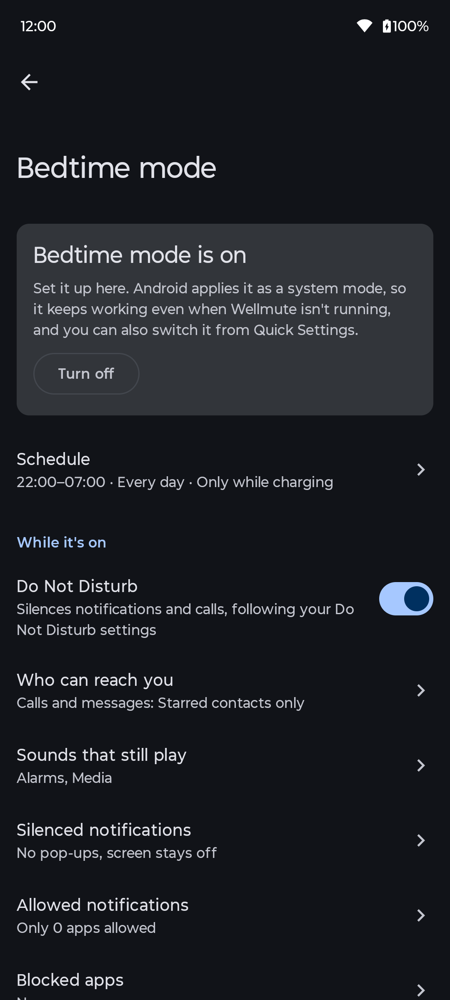

# Wellmute

**Wellmute is a free, open source alternative to Google's Digital Wellbeing for GrapheneOS and other Android phones without Google services.** It gives you per-app screen time, app timers, usage reminders, Focus mode and Bedtime mode, with no internet permission.

GrapheneOS doesn't ship Digital Wellbeing and it can't be installed, so its users have no per-app screen time, app timers, Bedtime mode or Focus mode. Wellmute brings them back, fully offline.

> **Status:** 0.4.0, the first public version. Everything below works and has been tested on GrapheneOS and Android 15. See [CHANGELOG.md](CHANGELOG.md).

## TL;DR

- **What it is:** a Digital Wellbeing alternative for GrapheneOS and any Android 15 or newer, with no Google Play Services needed.
- **What it does:** screen time per app by day, week, month and year; app timers; usage reminders; Focus mode; Bedtime mode.
- **Privacy:** no `INTERNET` permission, so nothing can leave your phone. No accounts, ads, analytics or trackers.
- **History from day one:** the moment you allow usage access, you see your last 7 days or so of screen time and unlocks, because Android keeps those records.
- **Trust:** every official APK is signed with the same key, which you can check with AppVerifier.

## Features

- **Dashboard:** screen time, unlocks and notifications by day, week, month or year; per-app usage over the same periods, with screen time, notifications and opens.
- **App timers:** daily limits per app. When time runs out, the app is paused until midnight.
- **Usage reminders:** an optional bubble while you use an app ("Calculator · 10 min today"), every 5 to 60 minutes. No sound, nothing in the notification shade.
- **Focus mode:** pause distracting apps on demand or on a schedule, with "take a break".
- **Bedtime mode:** grayscale, dim wallpaper, dark theme, no always-on display and Do Not Disturb, on a schedule. No ADB required.
- **Fewer interruptions at night:** let only the apps you choose through Bedtime, even if Android lets more through Do Not Disturb, and get the rest back, as they were, when Bedtime ends. Schedules for Do Not Disturb are left to Android's Modes.
- Home screen widget and Quick Settings tiles.

## Screenshots

<table>
  <tr>
    <td></td>
    <td></td>
    <td></td>
    <td></td>
    <td></td>
  </tr>
  <tr>
    <td align="center">Dashboard</td>
    <td align="center">App timers</td>
    <td align="center">Usage reminders</td>
    <td align="center">Focus mode</td>
    <td align="center">Bedtime mode</td>
  </tr>
</table>

More screens and how each feature works: [docs/features/FEATURES.md](docs/features/FEATURES.md).

## Wellmute vs Google Digital Wellbeing

**Wellmute has the same core tools as Google's Digital Wellbeing, and it is open source and runs on GrapheneOS, where Digital Wellbeing can't be installed.**

| | Wellmute | Google Digital Wellbeing |
|---|---|---|
| Open source | **Yes (GPL-3.0-or-later)** | No |
| Runs on GrapheneOS | **Yes** | No |
| Internet block | **Yes** | No |
| Screen time per app, unlocks and notifications | Yes | Yes |
| App timers | Yes | Yes |
| Focus mode | Yes | Yes |
| Bedtime mode | Yes | Yes |
| Price | Free | Free |

**Conclusion:** if your phone came with Digital Wellbeing and you use Google services, you already have the basics. If you use GrapheneOS, or want an open source app with no internet access, Wellmute is the alternative.

## Privacy

**Wellmute has no `INTERNET` permission, so it can't send anything anywhere.** No analytics, telemetry or crash reporting. All data stays on your device and is excluded from cloud backups. Its accessibility service is only told which app is in front: it can't read what's on screen. See [docs/PRIVACY.md](docs/PRIVACY.md) for the exact list of permissions and what each one is used for.

## Requirements

**Android 15 (API 35) or newer, with or without Google services.** Tested on a Pixel 9 with GrapheneOS 2026110800 (Android 17) and a moto g54 5G with Android 15.

## Verify your download

**Every official Wellmute APK is signed with the same key.** You can check it with [AppVerifier](https://github.com/soupslurpr/AppVerifier) by pasting this into it:

```
com.wellmute
50:65:FA:1B:3E:23:C5:FA:72:B1:71:93:F4:47:C5:73:AD:5B:46:6D:C0:1B:F6:ED:E8:16:CA:85:07:D0:2D:CF
```

Or on a computer, with the Android SDK's build tools:

```bash
apksigner verify --print-certs Wellmute-X.Y.Z.apk
```

The `SHA-256 digest` line must read `5065fa1b3e23c5fa72b17193f447c573ad5b466dc01bf6ede816ca8507d02dcf`. If it doesn't, don't install that APK.

## Common setup mistakes

- **"Restricted setting" when allowing a permission.** *Problem:* Android blocks accessibility and notification access for apps installed from a file. *Solution:* open Wellmute's App info, tap ⋮ → Allow restricted settings, then allow the permission again. Wellmute's setup walks you through it.
- **Timers or Bedtime stop working after a while.** *Problem:* battery optimization lets Android stop Wellmute in the background. *Solution:* allow the battery exemption Wellmute asks for during setup (Settings → Permissions).
- **Notifications show 0.** *Problem:* notification counts need notification access, and Android keeps no record of past notifications. *Solution:* allow notification access; counts start from that moment.
- **Usage reminders or timers never appear.** *Problem:* they need Wellmute's accessibility service to know which app is open. *Solution:* turn it on in Settings → Accessibility → Wellmute.

## FAQ

### Is there a Digital Wellbeing alternative for GrapheneOS?

**Yes: Wellmute.** GrapheneOS doesn't include Google's Digital Wellbeing and it can't be installed there. Wellmute gives you the same tools (screen time per app, app timers, Focus mode, Bedtime mode) as a free, open source app with no internet permission.

### How do I see screen time on GrapheneOS?

**Install Wellmute and allow usage access.** You'll see today's screen time, unlocks and every app's time right away, plus your last 7 days or so, because Android keeps those records even before you install it.

### Does Wellmute need internet access or Google Play Services?

**No.** It has no `INTERNET` permission and no proprietary dependencies, so it works on GrapheneOS and any Android 15 or newer without Google services.

### Can Wellmute see what I do inside apps?

**No.** It only learns which app is in front and for how long. Its accessibility service can't read the screen, and notification contents are never stored.

### How accurate is Wellmute's screen time?

**Within seconds of Android's own numbers.** In timed tests, per-app screen time was within 1 to 2 seconds of a stopwatch, and within 5 seconds of Android's own daily totals (own test, moto g54 5G, 11 November 2026). Apps left in the background, the lock screen and time with the screen off don't count. The full test is in [docs/decisions/0003](docs/decisions/0003-how-screen-time-is-counted.md).

### Does Wellmute work on phones that aren't Pixels?

**Yes, on any Android 15 or newer.** It's developed on a Pixel with GrapheneOS and also tested on a Motorola with Android 15.

### How do I check that my Wellmute APK is the official one?

**Compare its signing key with the one published above**, with [AppVerifier](https://github.com/soupslurpr/AppVerifier) on the phone or `apksigner` on a computer. If they don't match, don't install it.

## Contributing

Architecture decisions live in [docs/decisions](docs/decisions). All user-facing strings go in `values/strings.xml`, never hardcoded. The app is English-only for now.

## Donate

**Wellmute is free, with no ads and no tracking.** If it's useful to you, you can support its development:

**Monero (XMR)**

```
42W62vgtk2B5xTACMtnTYp4wRVy1bU8C7KdsKN1NATUXC5iqQN6gtZ1T7H42BKHGDqTThUc1Rp8dTAgVR1XJnpRpU5boZL9
```

**Bitcoin (BTC)**

```
bc1qdm2gkyg0fksqwtpmqx23a6zrjqwmu3vakjuctk
```

## In summary

- Wellmute is a free, open source Digital Wellbeing alternative for GrapheneOS and any Android 15 or newer.
- It has per-app screen time by day, week, month and year, app timers, usage reminders, Focus mode and Bedtime mode.
- It has no `INTERNET` permission: all data stays on the phone, with no accounts, ads or trackers.
- It shows your last 7 days or so of screen time as soon as you allow usage access.
- Its screen time matched Android's own totals within 5 seconds per app (own test, 11 November 2026).

## License

[GPL-3.0-or-later](LICENSE).
