# Wellmute features

Wellmute is a free, open-source app for taking back your time and muting the noise on your phone. It runs entirely on your phone: it has no internet permission, no accounts, no ads and no tracking.

Screenshots were taken on a moto g54 5G running Android 15 with the release build, in dark theme, with real usage from a test phone. Colours follow the phone's wallpaper (Material You).

---

## First launch

**Every permission explained, and every one optional.**
On first launch, three short pages explain what Wellmute does and how it keeps things private. Then it asks for one permission per step: what it's for, what it's never used for, and Allow or Skip for now. Any of them can be allowed later from Settings → Permissions.

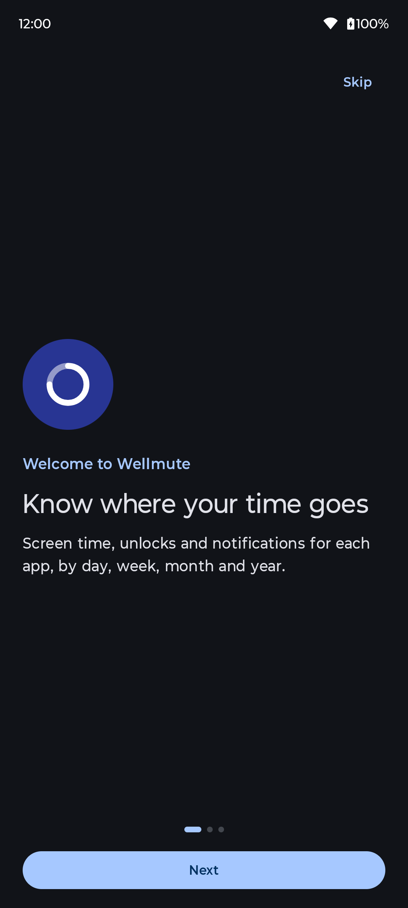

---

## Home

**Your day at a glance.**
Today's screen time as a ring, with unlocks and notifications underneath. Below, the tools are grouped into *Take back your time* and *Mute the noise*.

| | |
|---|---|
| 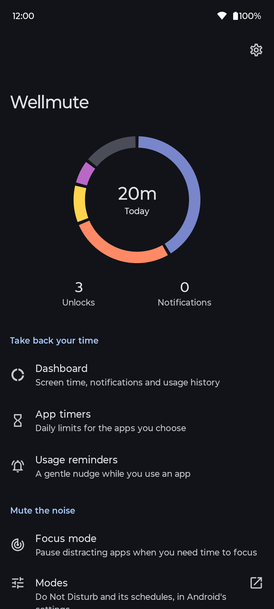 | 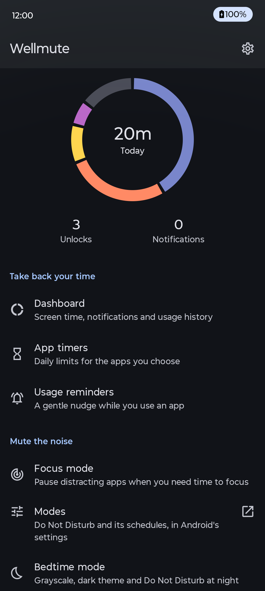 |

---

## Dashboard

### Day view
**See where your time goes.**
A ring of today's screen time split by your most used apps, your unlocks and notifications, and a bar chart of the last 7 days. Move day by day with the arrows, or tap the date to pick any day from a calendar.

| | |
|---|---|
| 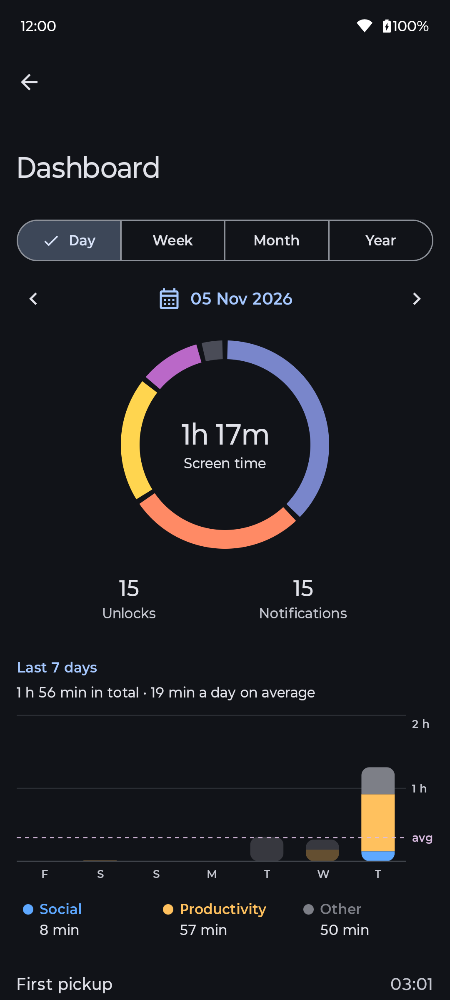 | 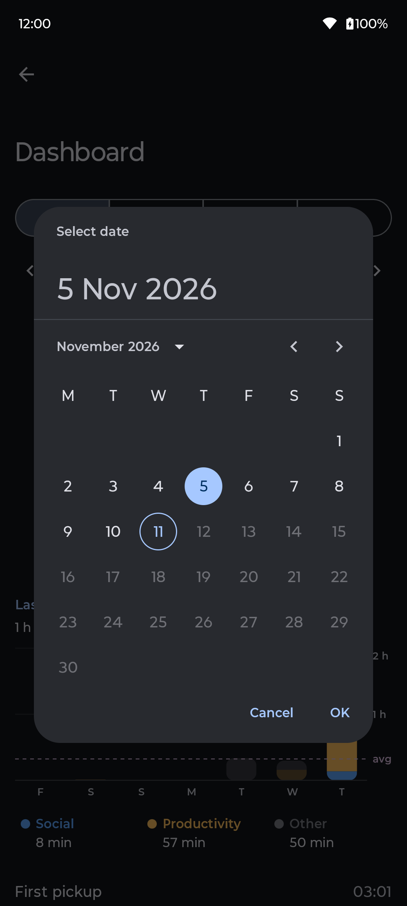 |

**Tap the ring to see which app it is.**
Tapping a slice shows that app's name, its time and its share of the day.

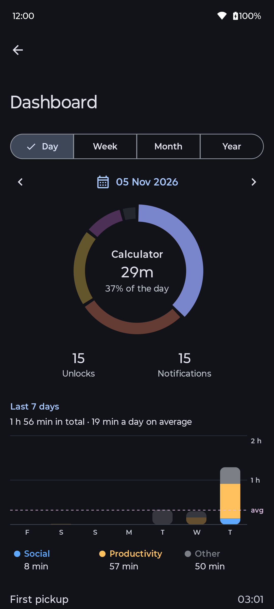

**Every app, sorted by time.**
Each app shows its time, notifications and opens, and an hourglass to set a timer.

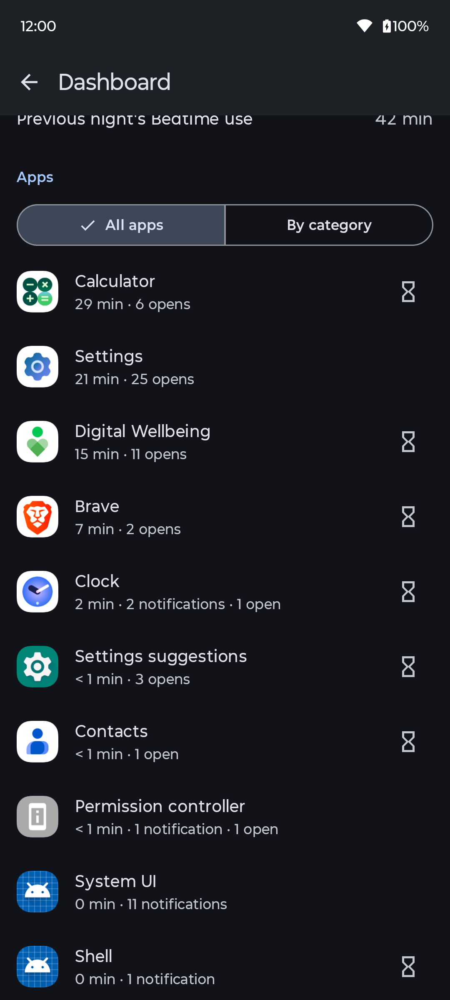

### Week, month and year
**Your habits over time.**
Switch between Day, Week, Month and Year. Each view shows your daily average, how it compares with the period before, a chart split by kind of app (Social, Entertainment, Games, Productivity, Other) with a scale on the right and the average as a labelled dashed line, your longest session, your use during Bedtime's hours and your use while Focus mode was on, and every app's totals. History is kept for as long as you use Wellmute.

| | | |
|---|---|---|
| 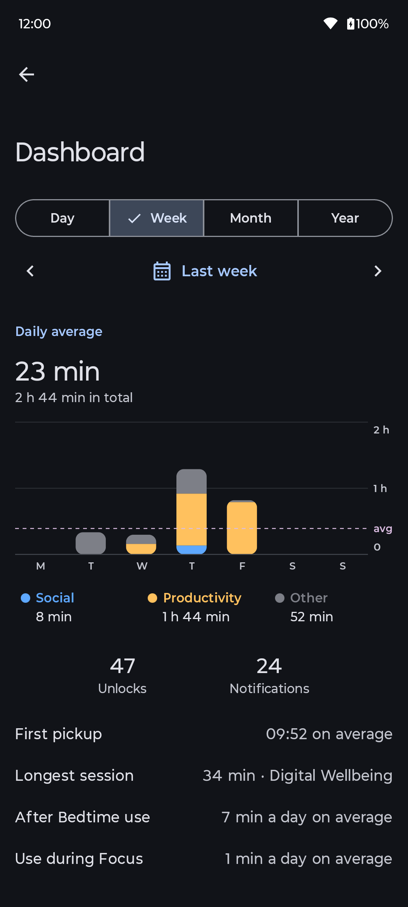 | 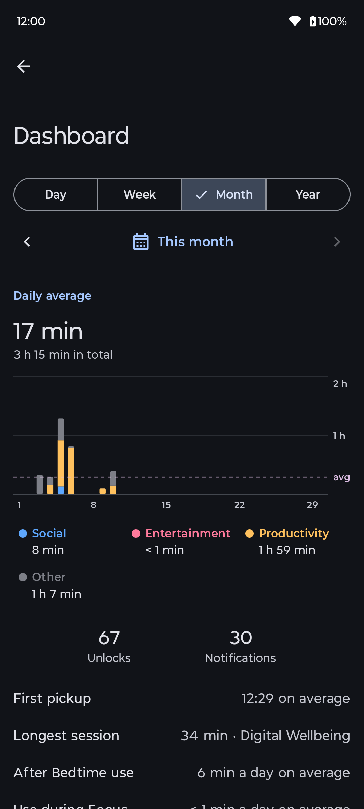 | 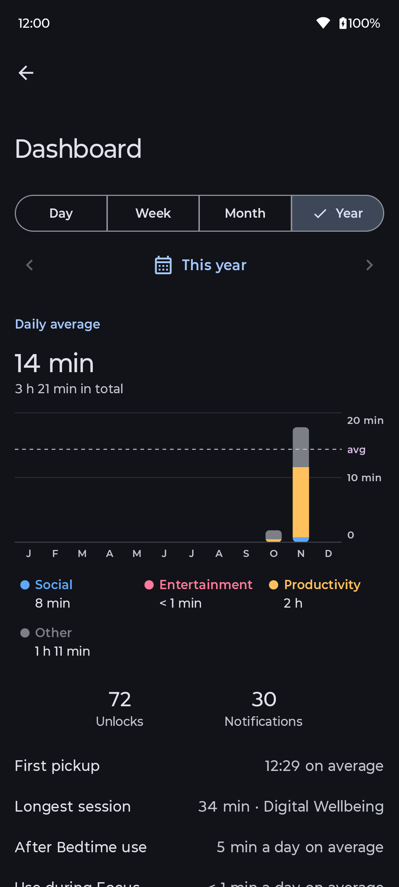 |

**Tap a bar to see that day (or month) without leaving the view.**

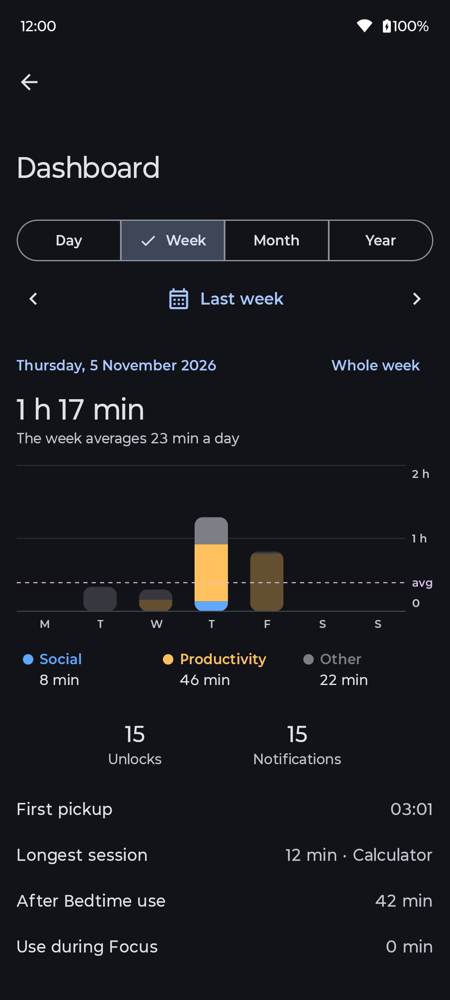

### App detail
**One app, in depth.**
Its timer, and its screen time, notifications or opens by day, week, month or year, on the same view the Dashboard was showing. Beside the number, how it compares with the same weekday last week, or with the week, month or year before. You can change which category it counts as.

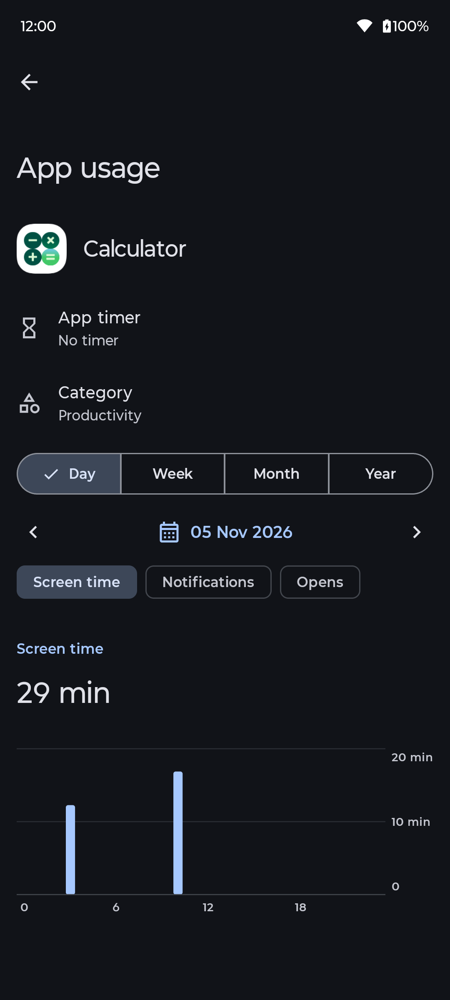

---

## App timers

**Set a daily limit for any app.**
Choose 20 minutes, 30 minutes, 1 hour, 2 hours, or any time with − and +, a minute at a time. A small bubble over the app warns you 5 minutes before time runs out; one switch on the App timers screen turns it on or off for every timer.

All your timers are in one place too: **App timers** on the home screen lists every app with a timer and how much time it has left today. Tap one to change or delete it, or **Add timer** to search for any app. They're the same timers you set from the Dashboard.

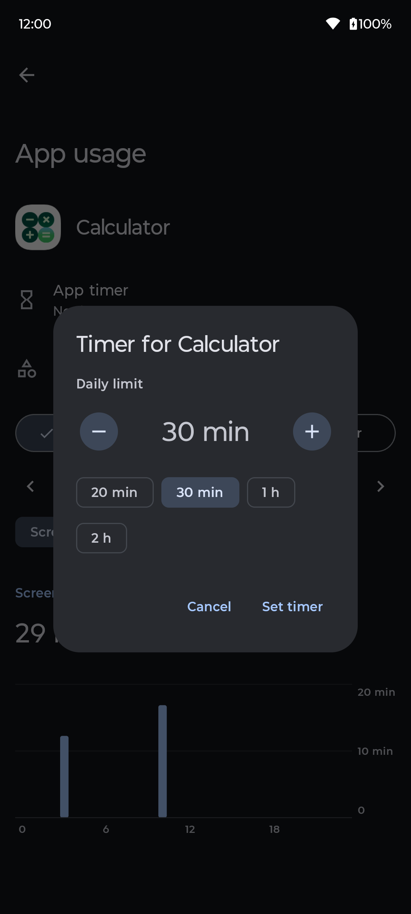

**When time's up, the app pauses until midnight.**
Opening it shows Wellmute's pause screen instead, and its notifications are hidden. Apps that could lock you out of your phone, such as Phone, Settings and your home screen, can't get a timer.

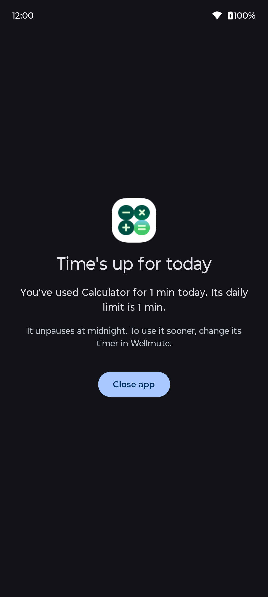

---

## Usage reminders

**A gentle nudge while you use an app.**
Off by default. When on, a small bubble floats at the top of the screen every 5, 10, 15, 30 or 60 minutes: "Calculator: 10 min today". It fades away after a few seconds, makes no sound and lets your taps go through. It isn't a notification, so it never clutters your notification shade.

| | |
|---|---|
| 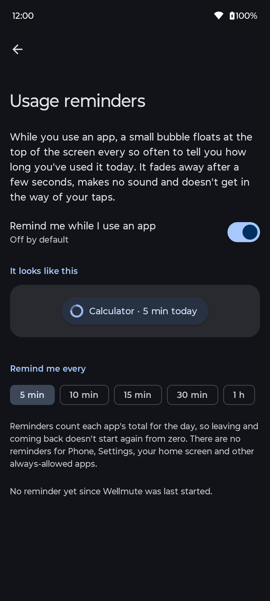 | 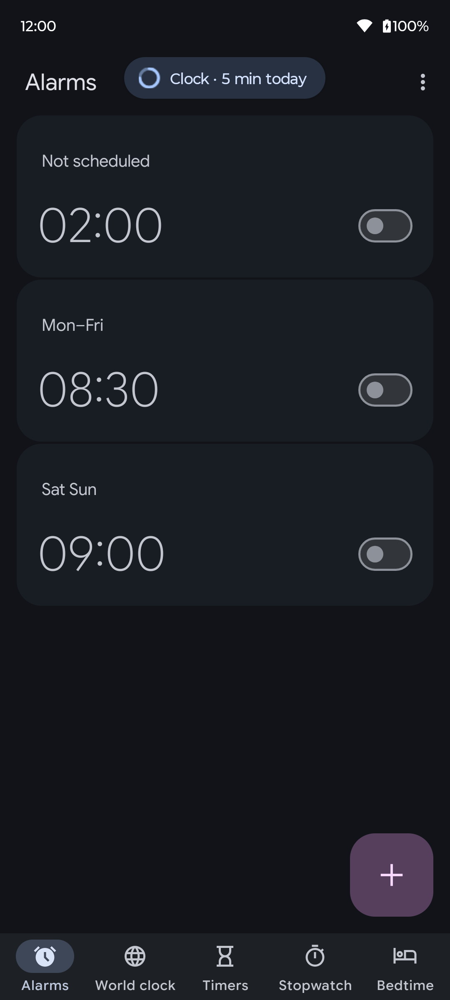 |

---

## Bedtime mode

**Wind down at night.**
Turn Bedtime on by hand, from Quick Settings, or on a schedule with the days you choose. It can turn on only while the phone is charging, and turn off with your first morning alarm.

While it's on, it can:
- turn on Do Not Disturb, with your own choice of who can reach you and which sounds still play;
- make the screen grayscale;
- dim the wallpaper;
- turn on dark theme;
- turn off the always-on display.

| | | |
|---|---|---|
| 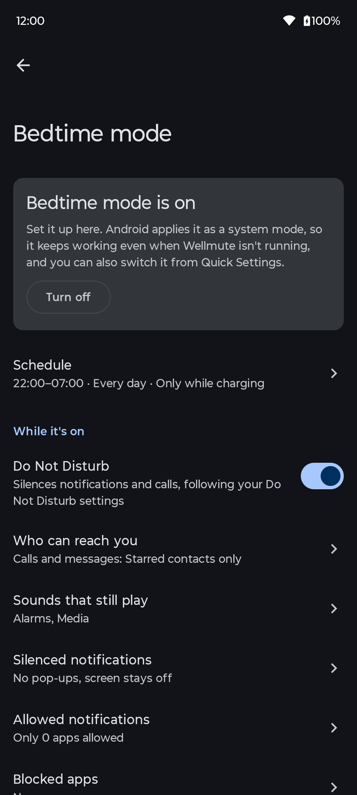 | 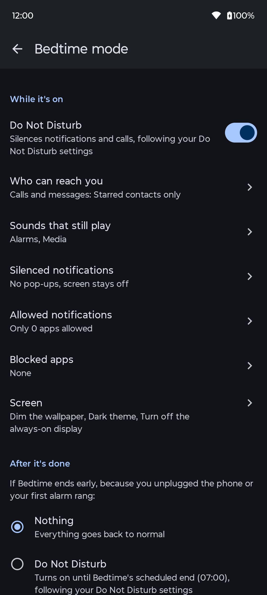 | 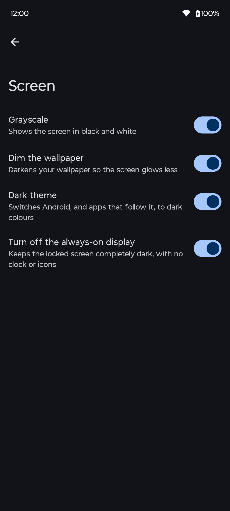 |

---

## Focus mode

**Pause distracting apps when you need to focus.**
Pick your distracting apps. While Focus mode is on, they're paused and their notifications are hidden. Turn it on by hand, from Quick Settings or on a schedule. Need a moment? Take a 5-minute break and it turns back on by itself, with a small bubble a minute before (you can turn that off).

| | | |
|---|---|---|
| 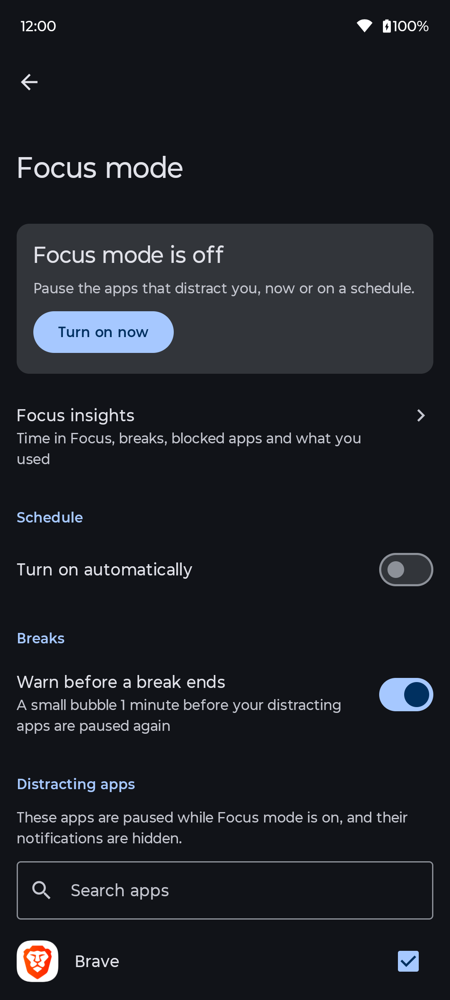 | 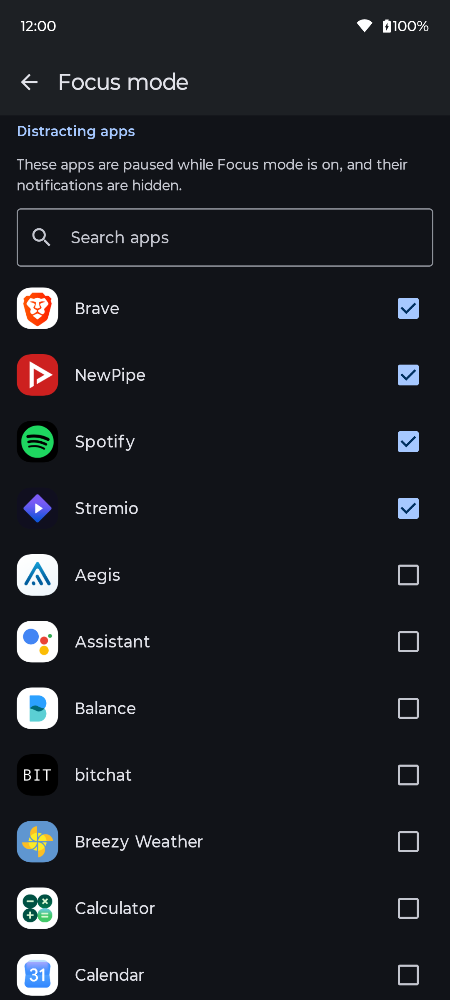 | 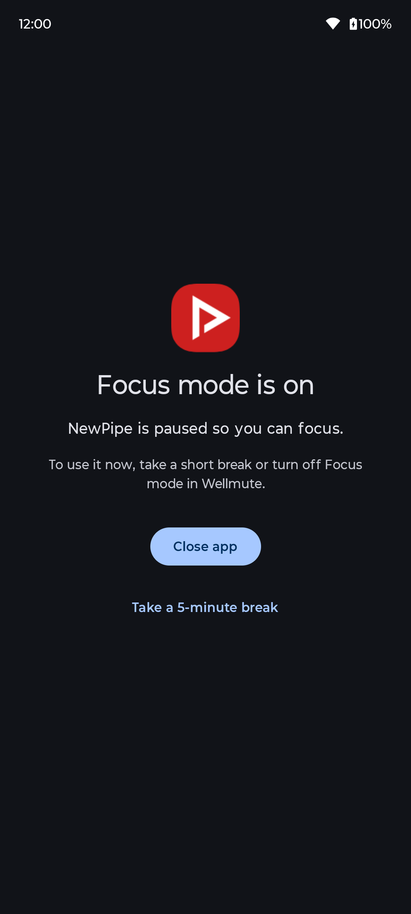 |

---

## Bedtime: silence apps at night

**Fewer interruptions at night than during the day.**
Android's Modes decides which apps can interrupt Do Not Disturb, and it's the same list for every mode. Bedtime lets you go further: turn on **Only let chosen apps through** and tick the few apps that may reach you at night. Wellmute removes every other app's notifications as they arrive, without a sound, even if Android would let them through. For example, your bank can still reach you but your calendar can't.

By default they aren't lost: **Deliver them when Bedtime ends** delays them with Android's own snooze, and they come back, as they were, as soon as Bedtime is over (or at its scheduled end).

**How silenced notifications show.** Bedtime also has Android's display options: whether silenced notifications light up the screen, appear on the always-on display, pop up, show a dot or a status bar icon, or appear in the pull-down shade. Each option explains its effect.

For Do Not Disturb on a schedule (Work, Study…), use Android's Modes: the **Modes** row on Home opens it.

---

## Quick Settings tiles and home screen widget

- **Tiles:** *Wellmute Focus* and *Wellmute Bedtime* switch each mode on and off from the Quick Settings panel.
- **Widget:** today's screen time and your top 3 apps on your home screen. Tap it to open Wellmute.

---

## Settings and privacy

**Always know what Wellmute can do.**
Settings shows each permission, why it's needed, what it's never used for, and whether it's allowed.

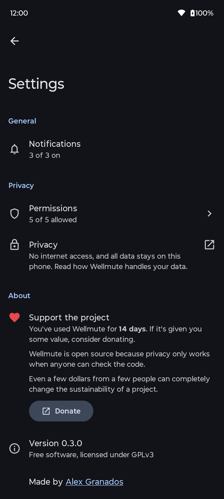

**Private by design.**
- No internet permission: nothing can leave your phone.
- No accounts, ads, analytics or trackers.
- History is stored only on your phone and is excluded from cloud backups.
- Free and open source (GPLv3).

